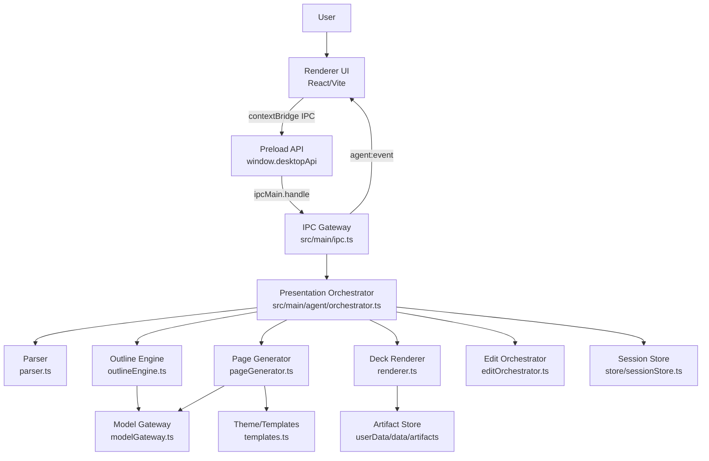
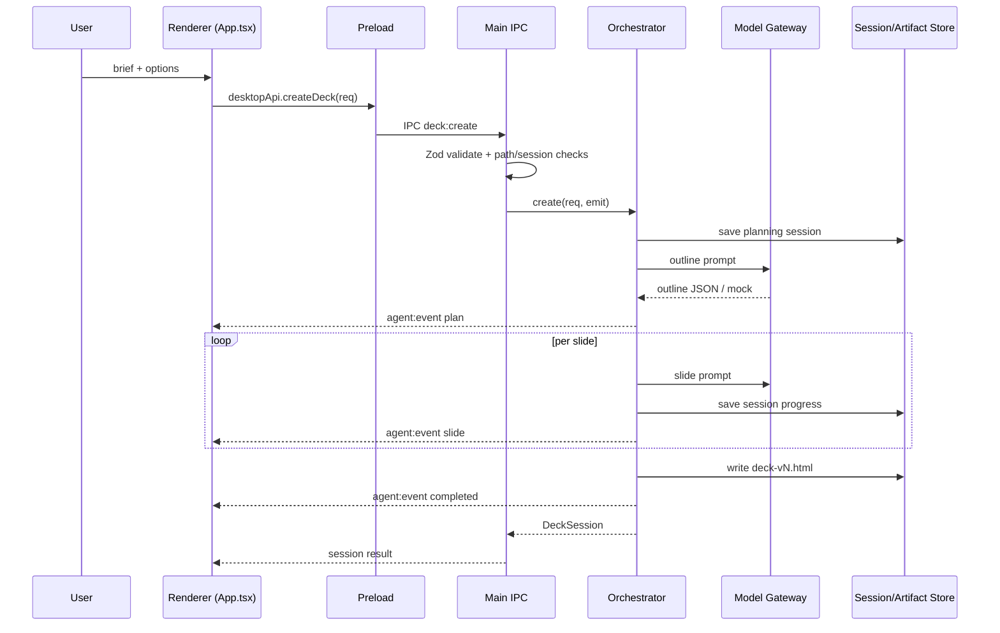
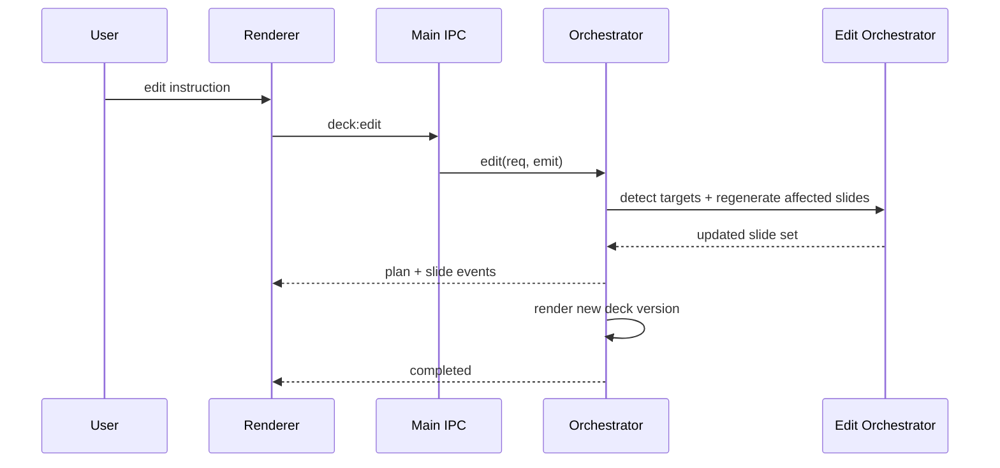

# AI Presentation Maker — Architecture

Part of the MyAI agent suite. This document describes the **agent architecture** and its **current desktop implementation** in this repository.

> Related docs: [Blueprint](./blueprint.md) · [Integration](./integration.md) · [Milestones](./milestone.md) · [TODOs](./todos.md) · [Desktop Stack](./desktop.md)

## 1. Purpose

The AI Presentation Maker turns a short natural-language brief into a complete, styled, multi-page presentation deck — and lets the user refine it conversationally.

**Contract:** given a topic (and optional constraints), produce a downloadable/openable slide deck artifact, with streaming progress.

## 2. Design Principles

| Principle | Meaning | Desktop implementation |
| --- | --- | --- |
| Prompt-in, deck-out | A single brief is enough to start. | `CreatePresentationRequest` over IPC `deck:create`. |
| Streaming-first | Slides appear progressively. | Main emits `plan/slide/warning/error/completed` via `agent:event`. |
| Deterministic where possible | Parsing/layout/rendering are deterministic; content is generative. | Parser/templates/renderer deterministic; outline/page text from Model Gateway. |
| Content ≠ style | Text and theme/layout are separate. | `templates.ts` theme + `pageGenerator.ts` layout binding. |
| Safe rendering | No active content in generated slides. | `security/sanitize.ts` (DOMPurify + JSDOM), iframe sandbox in renderer. |
| Composable | Typed contracts per stage. | Shared types in `src/shared/types.ts`, Zod validation in `src/shared/schema.ts`. |

## 3. High-Level Architecture



## 4. Component Breakdown (as implemented)

### 4.1 Desktop IPC Gateway (`src/main/ipc.ts`)

- **Responsibility:** validates IPC payloads, routes create/edit/get/list/export/open, broadcasts agent events to windows.
- **Security:** Zod request validation; export/open restricted to resolved paths under `userData/data/artifacts`.
- **Channels:** `deck:create`, `deck:edit`, `deck:get-session`, `deck:list-sessions`, `deck:export`, `deck:open-artifact`, `app:get-info`, `agent:event`.

### 4.2 Intent & Parameter Parser (`src/main/agent/parser.ts`)

- **Responsibility:** converts brief/options into `PresentationSpec`.
- **Behavior:** trims brief, infers audience, detects language (explicit > heuristic > default), normalizes style preset, maps page count to bucket.
- **Output:** typed `PresentationSpec` with no null required fields.

### 4.3 Outline Engine (`src/main/agent/outlineEngine.ts`)

- **Responsibility:** generates structured outline with cover/body/close.
- **Behavior:** prompts Model Gateway for JSON; validates with Zod; normalizes indexes; falls back to deterministic outline on invalid output.
- **Output:** `Outline { title, subtitle?, slides[] }`.

### 4.4 Page Generator (`src/main/agent/pageGenerator.ts`)

- **Responsibility:** generates per-slide content and binds to layout/theme.
- **Behavior:** calls Model Gateway for slide JSON, falls back to outline seed points, selects layout by role, renders HTML, sanitizes before returning.
- **Output:** streamed `Slide` objects.

### 4.5 Deck Assembler & Renderer (`src/main/agent/renderer.ts`)

- **Responsibility:** assembles slides into a self-contained HTML presentation artifact.
- **Behavior:** sanitizes slide HTML, writes versioned `deck-vN.html` under session artifact directory.
- **Output:** `DeckArtifact` with local `filePath`.

### 4.6 Delivery / Export (desktop)

- **Local delivery:** artifact path stored in session; renderer can open via OS or export via save dialog.
- **Future cloud delivery:** replace local artifact path with object storage + time-scoped URL (see [Integration](./integration.md)).

### 4.7 Edit Orchestrator (`src/main/agent/editOrchestrator.ts`)

- **Responsibility:** targets affected slides and regenerates only those.
- **Current heuristic:** explicit `targetSlides`, or slide numbers mentioned in instruction, else body slides.
- **Output:** updated session with regenerated slides and new artifact version.

### 4.8 Supporting Services

| Service | Current implementation | Target/production |
| --- | --- | --- |
| Model Gateway | `modelGateway.ts`: HTTP OpenAI-compatible + `MockModelGateway` fallback | Central provider-agnostic gateway, retries, budgets, safety filters |
| Template Store | `templates.ts` static preset map | Versioned template service |
| Asset Store | Not yet implemented | Images/icons/fonts service |
| Session Store | `store/sessionStore.ts` JSON file in `userData/data` | Durable DB/KV/session service |
| Telemetry | `telemetry/logger.ts` structured console logs | Traces, metrics, OTLP/exporter |
| Security | `security/sanitize.ts` DOMPurify | Sandbox renderer, audit logs, policy engine |

## 5. Data Model (implemented)

```ts
interface PresentationSpec {
  sessionId: string; mode: 'create' | 'edit'; topic: string; audience: string;
  language: string; pageCountBucket: PageCountBucket | string;
  styleClass: StylePreset; templateId: string; referenceDocs: string[]; brief: string;
}

interface Outline {
  title: string; subtitle?: string;
  slides: Array<{ index: number; role: 'cover'|'body'|'close'; headline: string; points: string[] }>;
}

interface Slide {
  index: number; role: 'cover'|'body'|'close'; layout: 'cover'|'title-and-bullets'|'section'|'closing';
  theme: string; content: { headline: string; bullets: string[]; notes?: string }; html: string;
}

interface DeckArtifact {
  sessionId: string; version: number; slideCount: number; filePath: string; previewPath?: string; createdAt: string;
}
```

See `src/shared/types.ts` for the authoritative contracts.

## 6. Sequence Flows

### 6.1 Create (desktop)



### 6.2 Edit (desktop)



## 7. State, Storage & Idempotency

- **Session state:** `userData/data/sessions.json` (current desktop MVP). Each edit produces a new deck version.
- **Artifacts:** `userData/data/artifacts/<sessionId>/deck-vN.html`.
- **Idempotency:** not yet enforced by idempotency key; IPC handlers are request-scoped. Production target: idempotency keys on create/edit.
- **Caching:** static template map in memory; future template/asset cache.

## 8. Technology Stack (current)

| Layer | Current |
| --- | --- |
| Desktop shell | Electron 30+ |
| UI | React 18 + TypeScript + Vite + electron-vite |
| IPC bridge | Electron preload + `contextBridge` typed API |
| Validation | Zod (IPC boundary) + TS types |
| Agent orchestration | Node.js main-process modules |
| Model access | HTTP OpenAI-compatible gateway adapter + offline mock fallback |
| Rendering | Sanitized HTML slide fragments assembled into self-contained HTML deck |
| Storage | Local JSON session store + local artifact files |
| Packaging | electron-builder |
| Verification | `npm run typecheck`, `npm run build`, `npm test` (smoke-build) |

## 9. Non-Functional Targets

| Attribute | Target | Current status |
| --- | --- | --- |
| First slide visible | seconds | Streaming slide events implemented |
| Full deck | ~1 min standard | Depends on model gateway; mock is immediate |
| Safety | no active content | DOMPurify + iframe sandbox |
| Portability | self-contained artifact | HTML deck artifact; PPTX/PDF future |
| Testability | stage isolation | Typecheck/build pass; smoke test present; unit/E2E pending |

## 10. Security, Privacy & Compliance

- Renderer isolated: `contextIsolation: true`, `nodeIntegration: false`.
- Minimal preload surface: explicit methods only.
- Generated HTML sanitized before storage and before preview.
- IPC export/open paths restricted to artifact root.
- Model credentials remain in main process/env.
- Reference docs treated as data, never instructions.

## 11. Extensibility

- **New styles/templates:** add preset in `src/shared/constants.ts`, then theme tokens and role previews in `src/shared/templateCatalog.ts`; `src/main/agent/templates.ts` resolves them into render themes.
- **New output formats:** add renderer behind `DeckArtifact` contract (PPTX/PDF exporter).
- **New model providers:** implement `ModelGateway` adapter.
- **New modalities:** extend `SlideContent` and layout renderer; keep sanitization.
- **Cloud migration:** swap local session/artifact stores with service adapters per [Integration](./integration.md).
