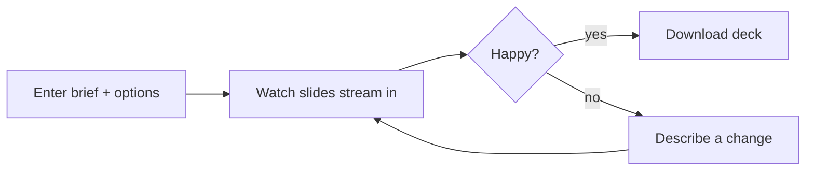

# AI Presentation Maker — Product & Engineering Blueprint

Part of the MyAI agent suite.

> Related docs: [Architecture](./architecture.md) · [Integration](./integration.md) · [Milestones](./milestone.md) · [TODOs](./todos.md)

## 1. Vision

Make it effortless for anyone — with no design skills — to go from a thought to a polished slide deck
in a single conversational step, and to iterate on it just as easily.

**North-star metric:** % of sessions that end in a delivered deck the user keeps (doesn't immediately regenerate from scratch).

## 2. Goals & Non-Goals

### Goals

- Accept a one-line brief and produce a coherent, multi-page, well-styled deck.
- Stream progress so the user never waits on a blank screen.
- Support follow-up edits in natural language.
- Work across languages.
- Deliver a portable, downloadable file.

### Non-Goals (for v1)

- Real-time multi-user co-editing.
- Full pixel-level manual design editor.
- Arbitrary file-format fidelity (e.g. importing existing `.pptx` and preserving every effect).
- Live data binding / spreadsheet-driven charts.

## 3. Target Users

| Persona | Need |
| --- | --- |
| Student | Fast, clean lecture / project decks. |
| Knowledge worker | Internal updates, reports, proposals. |
| Founder / marketer | Pitch & campaign decks, quick iteration. |
| Educator | Courseware and teaching material. |

## 4. Scope

### In scope

- Brief → outline → pages → deck → download.
- Style presets & templates.
- Conversational editing.
- Multi-language output.
- Optional reference-document grounding.

### Out of scope (v1)

- Template marketplace / user-uploaded themes.
- Automatic data visualisation from raw datasets.
- Offline / on-prem deployment.

## 5. Key Features

1. **Brief-to-deck** — topic + audience → full deck.
2. **Style presets** — a curated catalogue (e.g. Business, Education, Research, Marketing, Technology, Portfolio, Lifestyle, Corporate, Healthcare).
3. **Length control** — page-count buckets from very short to very long.
4. **Streaming preview** — slides render progressively.
5. **Conversational edit** — "add a slide", "make slide 4 a chart", "change theme".
6. **Multi-language** — output language follows the request.
7. **Reference grounding** — optional uploaded docs steer content.
8. **One-click delivery** — downloadable deck + preview card.

## 6. User Experience Flow

### Create flow

1. User expresses intent (topic, audience, optional style/length/language).
2. Agent confirms parameters implicitly by starting generation.
3. Slides appear progressively with a preview.
4. User downloads or edits.

### Edit flow

1. User describes a change.
2. Agent identifies affected slides.
3. Only those slides regenerate; the rest stay put.
4. Updated deck is re-delivered.

## 7. Component Blueprint (product view)

| Module | User-visible behaviour |
| --- | --- |
| Brief Interpreter | Understands what the deck is about and for whom. |
| Outline Planner | Decides structure and slide count. |
| Slide Writer | Writes each slide's copy. |
| Layout Binder | Applies look & feel. |
| Deck Builder | Produces the final file. |
| Refiner | Handles edits. |
| Deliverer | Hands over the file. |

## 8. Style & Template Catalogue (initial)

| Preset | Typical use |
| --- | --- |
| Business | Pitch decks, strategy, OKRs |
| Education | Courseware, lectures, training |
| Research | Papers, analysis, data-heavy reports |
| Marketing | Campaigns, launches, brand |
| Technology | Architecture, engineering reviews |
| Portfolio | Personal/studio showcases |
| Lifestyle & Travel | Guides, lifestyle |
| Corporate | Annual reports, company overviews |
| Healthcare | Medical, clinical, public health |

## 9. Output Specification

- **Format:** a single self-contained presentation file.
- **Structure:** ordered slides with a consistent theme.
- **Fidelity:** text, bullets, images, simple charts, and consistent typography.
- **Portability:** opens in common viewers without special tooling.

## 10. Acceptance Criteria (v1)

- [ ] A one-line brief yields a coherent deck with cover, body, and closing.
- [ ] Requested page-count bucket is respected (± one slide).
- [ ] Requested language is honoured.
- [ ] Style preset visibly changes the look.
- [ ] Editing one slide leaves others unchanged.
- [ ] Delivered file downloads and opens correctly.
- [ ] No active content in generated pages.

## 11. Metrics / KPIs

| Metric | Definition |
| --- | --- |
| Success rate | % requests ending in delivered deck |
| Time-to-first-slide | Seconds until slide 1 appears |
| Edit-acceptance rate | % edits kept by users |
| Rework rate | % decks regenerated from scratch |
| Crash / blank-deck rate | % runs failing to produce a file |

## 12. Constraints, Assumptions & Risks

### Constraints

- Dependent on an upstream model gateway.
- Renderer runs sandboxed (no arbitrary scripts).

### Assumptions

- Users accept an auto-chosen template by default.
- Decks are text/image/chart oriented, not data-bound.

### Risks

| Risk | Impact | Mitigation |
| --- | --- | --- |
| Incoherent outline | Poor deck structure | Schema-validated outline + low temperature |
| Overflow / clipping on slides | Unreadable pages | Pre-render overflow validation |
| Long generation time | User drops off | Streaming preview + skeleton placeholders |
| Edit regressions | Unwanted changes | Diff-aware, slide-scoped regeneration |
| Provider outage | No output | Multi-provider gateway + graceful failover |
