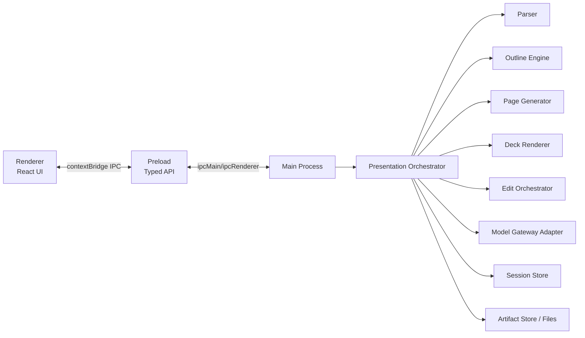

# AI Presentation Maker — Desktop Stack

> Companion to [Architecture](./architecture.md) and [Integration](./integration.md). This document describes the **desktop implementation** of the agent.

## 1. Desktop Goals

- Run the full brief→deck agent locally as a desktop app.
- Keep secrets and model calls in the main process.
- Stream generation events to the UI for immediate feedback.
- Persist sessions and artifacts locally.
- Package for macOS, Windows, and Linux.

## 2. Process Model



## 3. Main Process Responsibilities

| Module | Responsibility |
| --- | --- |
| `src/main/index.ts` | Create window, lifecycle, register IPC |
| `src/main/ipc.ts` | Validate/route IPC requests, emit agent events |
| `src/main/agent/orchestrator.ts` | End-to-end create/edit pipeline |
| `src/main/agent/parser.ts` | Brief → `PresentationSpec` |
| `src/main/agent/outlineEngine.ts` | Spec → validated `Outline` |
| `src/main/agent/pageGenerator.ts` | Outline slide → sanitized `Slide` |
| `src/main/agent/renderer.ts` | Slides → self-contained HTML deck artifact |
| `src/main/agent/editOrchestrator.ts` | Targeted slide regeneration |
| `src/main/agent/modelGateway.ts` | Real HTTP gateway + offline mock fallback |
| `src/main/store/sessionStore.ts` | Local session persistence |
| `src/main/security/sanitize.ts` | HTML sanitization (DOMPurify + JSDOM) |

## 4. IPC Contract

| Channel | Direction | Purpose |
| --- | --- | --- |
| `deck:create` | renderer→main | Create deck from brief/options |
| `deck:edit` | renderer→main | Apply natural-language edit |
| `deck:get-session` | renderer→main | Load session |
| `deck:list-sessions` | renderer→main | List recent sessions |
| `deck:export` | renderer→main | Save artifact to user-selected path |
| `deck:open-artifact` | renderer→main | Open artifact in OS default app |
| `app:get-info` | renderer→main | App/version/platform |
| `agent:event` | main→renderer | Streaming `plan/slide/warning/error/completed` |

## 5. Local Data

```text
userData/
  data/
    sessions.json               # session metadata + latest state
    artifacts/
      <sessionId>/
        deck-v1.html
        deck-v2.html
```

- Artifacts are versioned per session.
- Export copies the artifact to a user-chosen location.
- Future: move to SQLite for indexing and content-addressed blob store.

## 6. Streaming Events

The renderer subscribes to `agent:event`:

- `plan` — outline ready.
- `slide` — one slide generated; UI renders immediately.
- `warning` — non-fatal issue.
- `error` — terminal failure with correlation id.
- `completed` — artifact ready; export/open enabled.

## 7. Security Model

- **Renderer isolation:** `contextIsolation: true`, `nodeIntegration: false`.
- **Minimal bridge:** preload exposes only explicit methods.
- **Sanitization:** all generated HTML passes DOMPurify; scripts/iframes/event handlers forbidden.
- **Secret boundary:** API keys live in env/main process, never in renderer.
- **Reference safety:** reference docs treated as data, never instructions.

## 8. Packaging

`electron-builder` targets:

- macOS: `dmg`, `zip`
- Windows: `nsis`
- Linux: `AppImage`, `deb`

Build flow:

```bash
npm run build        # electron-vite build
npm run package:mac  # electron-builder --mac
```

## 9. Operational Modes

| Mode | Config | Behaviour |
| --- | --- | --- |
| Offline/mock | no `MODEL_GATEWAY_URL` | Deterministic mock generation, full UI flow works |
| Gateway | `MODEL_GATEWAY_URL` set | Real LLM calls via OpenAI-compatible chat completions endpoint |

## 10. Desktop TODOs

- [ ] Add SQLite session/artifact index.
- [ ] Add PPTX export via renderer pipeline.
- [ ] Add secure credential storage (OS keychain).
- [ ] Add auto-update feed and signing.
- [ ] Add E2E tests (Playwright + Electron).
- [ ] Add crash/telemetry opt-in reporting.
