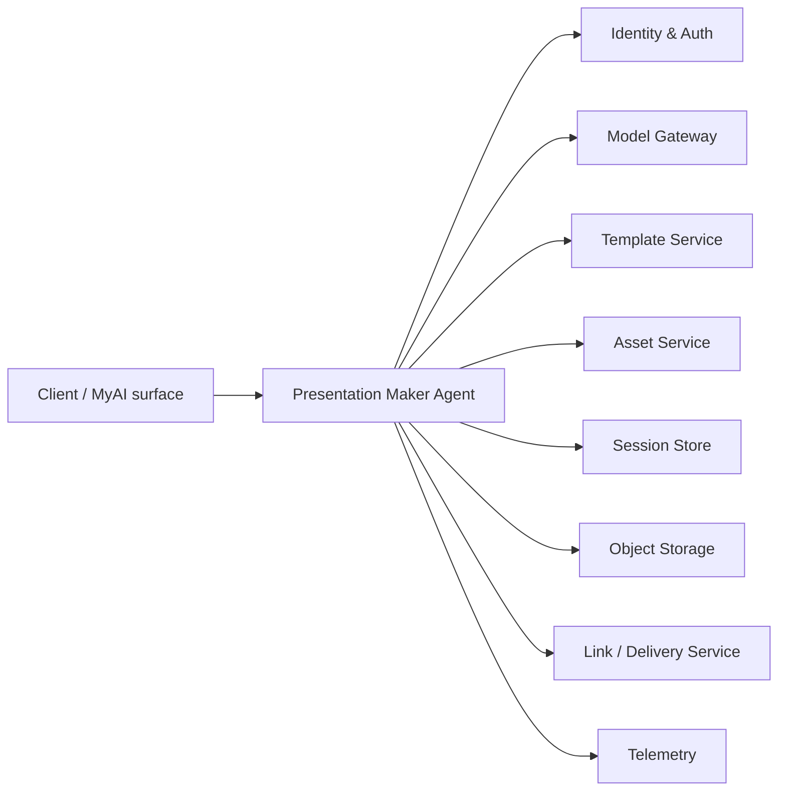

# AI Presentation Maker — Integration Guide

Part of the MyAI agent suite.

> Related docs: [Architecture](./architecture.md) · [Blueprint](./blueprint.md) · [Milestones](./milestone.md) · [TODOs](./todos.md)

## 1. Overview

This document describes how the AI Presentation Maker integrates with the surrounding MyAI platform:
identity, model access, template/asset services, session storage, delivery, and telemetry.

The pipelines below are illustrative contracts — they describe the integration surface and the
expected behaviour, not a frozen wire format.

## 2. Integration Points



| # | Integration | Direction | Purpose |
| --- | --- | --- | --- |
| 1 | Identity & Auth | inbound | Authenticate caller, scope data |
| 2 | Model Gateway | outbound | LLM calls for outline & pages |
| 3 | Template Service | outbound | Fetch layout/theme bundles |
| 4 | Asset Service | outbound | Fetch images/icons/fonts |
| 5 | Session Store | read/write | Persist deck state across turns |
| 6 | Object Storage | write | Store rendered artifacts |
| 7 | Link / Delivery | outbound | Mint time-scoped download URLs |
| 8 | Telemetry | outbound | Traces, metrics, quality signals |

## 3. Entry Contract (illustrative)

### 3.1 Create a deck

```http
POST /presentations
Authorization: Bearer <token>
Content-Type: application/json

{
  "brief": "A 12-slide deck about renewable energy for investors",
  "options": {
    "language": "en",
    "page_count": "10-15",
    "style": "Business",
    "reference_files": ["file://..."]
  }
}
```

Response (streamed):

```text
// event: plan      -> { "outline": { ... } }
// event: slide     -> { "index": 1, "html": "..." }   (repeats)
// event: completed -> { "deck": { "file_url": "...", "preview": "..." } }
```

### 3.2 Edit a deck

```http
POST /presentations/{session_id}/edits
Authorization: Bearer <token>

{ "instruction": "Turn slide 4 into a bar chart", "target_slides": [4] }
```

Response: streamed updated slides, then `completed` with a new version.

### 3.3 Fetch status / artifact

```http
GET /presentations/{session_id}       # current version + metadata
GET /presentations/{session_id}/file  # 302 -> time-scoped download URL
```

## 4. Streaming Semantics

- **Transport:** server-sent events (or chunked JSON stream).
- **Event types:** `plan`, `slide` (repeated), `warning`, `error`, `completed`.
- The client should render slides incrementally and only enable "download" after `completed`.
- Every stream ends with exactly one terminal event (`completed` or `error`).

## 5. Authentication & Authorization

- All inbound calls carry an identity token; the agent derives a `user_id` scope.
- Sessions are owned by a user; cross-user access is rejected.
- Provider credentials are never sent to clients and are resolved server-side by the Model Gateway.

## 6. Error Handling & Retries

| Condition | Behaviour |
| --- | --- |
| Invalid payload | 400 + field-level message, no session created |
| Unauthorized | 401/403, no work started |
| Model timeout | Retry with backoff on the stage, not the whole request |
| Partial slide failure | Emit `warning`, keep going, note slide in final summary |
| Storage/delivery failure | `completed_with_warnings`; provide retry link |
| Everything fails | Single terminal `error` event with a correlation id |

**Idempotency:** clients send an idempotency key on create/edit to make retries safe.

## 7. Quotas, Rate Limits & Cost Controls

- Per-user and global rate limits on create/edit.
- Token budgets per deck, enforced by the Model Gateway.
- Oversized reference documents are truncated/summarised before grounding.

## 8. Storage & Delivery

- Artifacts are stored content-addressed; identical renders dedupe.
- Download URLs are time-scoped and revocable.
- A lightweight preview (thumbnail) is produced alongside the file.

## 9. Observability Hooks

Emit, per request:

- `trace_id` / `session_id` propagated across all stages.
- Per-stage latency and token usage.
- Quality signals: outline validity, overflow warnings, blank-slide count, edit diffs.
- Terminal outcome (`completed` / `error`).

## 10. Configuration & Environment

| Key (conceptual) | Purpose |
| --- | --- |
| `MODEL_GATEWAY_URL` | Where LLM calls go |
| `TEMPLATE_SERVICE_URL` | Template/theme source |
| `ASSET_SERVICE_URL` | Media source |
| `SESSION_STORE_URL` | Durable state |
| `STORAGE_BUCKET` | Artifact destination |
| `LINK_TTL_SECONDS` | Download link lifetime |
| `MAX_TOKENS_PER_DECK` | Cost guardrail |
| `RENDER_SANDBOX` | Isolation flags for the renderer |

## 11. Versioning & Compatibility

- Integration surface is versioned; breaking changes ship behind a new version.
- Templates/themes are versioned independently and pinned per session so edits stay consistent.
- The `Deck` artifact contract is the stable boundary between rendering and delivery.

## 12. Integration Checklist

- [ ] Identity token validated on every inbound call.
- [ ] Model Gateway reachable + failover configured.
- [ ] Template & asset services healthy.
- [ ] Session Store durable and scoped.
- [ ] Storage bucket writable; content addressing enabled.
- [ ] Delivery links time-scoped + revocable.
- [ ] Telemetry wired for all stages.
- [ ] Idempotency keys honoured on create/edit.
